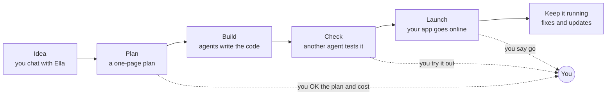

# Agentic Team

_An open-source multi-agent development framework. In plain words: an AI team that helps you build your app._

**Have an idea for an app? Build it, with an AI team to help.**

You tell your idea to Ella, an AI you chat with, a bit like ChatGPT. She asks you some questions, writes a short plan and tells you what it will cost. When you say yes, her team of AI helpers builds it. We call these helpers agents. Each agent has one job. One agent builds, and a different one checks the work, like a teacher marking homework. Ella comes back to you only when you need to decide something.

- **It's free.** Agentic Team is a set of written instructions anyone can read. This project makes no money, and nobody sells you anything here.
- **It runs on your computer.** Your app's files stay on your computer and in your own accounts.
- **It teaches as it goes.** This is a learning project. Ella explains each step, so you learn how good software is planned, built and checked. The aim is to help new builders do it safely and properly, instead of throwing away code an AI wrote in a hurry.

## Can't a chatbot or coding assistant do this?

A chatbot can write code, but you copy, set up and fix it yourself. A coding assistant does more, but nobody else checks its work. Here is what Ella's team adds.

| | One AI on its own | Ella and her team |
|---|---|---|
| Plans with you first | Only if you ask. | Yes. You agree on a plan before any work starts. |
| Checks the work | It checks itself, or you do. | A different AI does, using tests from your plan. |
| Lets you try it first | No. | Yes. You try each new version and say yes or no before it goes live. |
| Tells you the cost first | No. | Yes, and it stops before going over your budget. |
| Remembers next week | Only what's in the chat. | Everything: plans, choices and test results, saved in your own account. |
| Helps you learn | Only if you ask. | Yes. Ella explains each step in plain words. |

## What you'll need

- **A coding assistant.** This is an AI like ChatGPT that can also work with the files on your computer. Claude Code is the one we've tested most. Codex and Cursor work too. Most need a paid plan from the AI company, so check the price first.
- **A free GitHub account.** GitHub is a website that keeps a safe copy of your app's files, a bit like Google Drive for code.
- **About 15 minutes for setup.** You paste one line into your coding assistant, and it does the rest. In the Claude app's Code tab you never need the terminal, the plain window where people type commands.

## Where your money goes

This project makes no money. There are no ads, no sign-up and nothing to buy from us.

- **The AI tool.** Usually a monthly plan from the AI company. This is where most of your money goes, because it pays for the AI doing the work. Check the price on the company's own website. Before a big job, Ella tells you roughly how much of your AI plan it will use.
- **Putting your app online.** Often free to start. Many companies have a free plan that's enough for a small app. Ella picks free options first, and asks you before anything costs money.
- **Your own web address.** Optional. A name like myapp.com costs a small fee each year.
- **GitHub and this team.** Free.

Why spend on planning and checking at all? Because an app that's planned, tested and saved properly is one you can keep improving for years. A rushed one often has to be thrown away and started again.

## Before you start, know this

- It's new. It hasn't built a real app all the way from idea to launch yet. That's the next step.
- It's slower than asking one AI, because several agents plan and check the work. That uses more of your AI plan, so it may cost more.
- Website builders like Lovable, Bolt or Replit make a first version faster. If you need something to show tonight, use one.
- Tests can still miss mistakes. The work is only as good as the AI in your coding assistant.
- It works best in Claude Code today. Codex and Cursor read the same instructions. Nobody has tried Gemini CLI yet.
- Developers can use it too, to have one AI's work checked by another.

## How a project goes



Ella needs you at a few points: to OK the plan and cost, to try each new version, before any new spending, and before launch. The team does the rest. Ask Ella "tell me more" about anything. If you don't, she keeps things short.

## Your first project

Here's the whole setup. The "Your first project" lesson on our website shows the same steps with more help.

**1. Get two things ready.**

- A coding assistant: an AI like ChatGPT that can also work with the files on your computer. The Claude app is the one we've tested most; install it and sign in. [See which others work](https://agents.teamnightshift.org/learn/words.html#reach).
- A safe place for your app's keys. A key is a long password that lets your app use another service. Use any password manager you like (your phone or computer may have one built in), or a private file kept outside your project folder. Never paste a key into a chat.

That's all you do by hand. Ella installs Git and GitHub's tool for you during setup, after asking. No GitHub account yet? She opens the sign-up page and walks you through it; you type the details, because GitHub checks you're a person. Mac and Linux are tested. Windows should work, but nobody has tested it all the way yet.

**2. Open a new folder.** In the Claude app, click Code, pick Local, then Open folder… and make a new folder for your app. In a terminal, open it in the folder and type `claude`. With Cursor, open the app and pick the folder.

**3. Paste this one line,** with your idea at the end:

```text
Set up Agentic Team here by following https://raw.githubusercontent.com/vibhortayal/agentic-team-oss/main/START.md. My idea: <what you want, in your own words>
```

Ella says hello and gets your computer ready, asking before each install. You click Yes on your computer's pop-ups and Authorize once on GitHub. She adds the team to your folder, saves a first snapshot and makes your app's private repository on GitHub. Then she asks about your idea.

In Claude Code you can use our plugin instead. Type `/plugin install agentic-team --marketplace vibhortayal/agentic-team-oss`, then `/agentic-team:start` and your idea.

**4. Next time, just say hello to Ella.** Open your coding assistant in the same folder and paste this:

```text
You are Ella, the Engagement Lead. Read AGENTS.md and .team/roles/engagement-lead.md. <what you want, in your own words>
```

**5. Let Ella set up GitHub for the team.** After you OK the plan, Ella turns on the automatic checks and fills in the settings. She uses your sign-in, and asks first. You don't need to find your way around GitHub. The [Set up GitHub lesson](https://agents.teamnightshift.org/learn/setup.html) shows what she does, and which steps you can skip on a first try.

**6. Try each change, then say yes.** Ella sends a link to try each new version. Say yes, or tell her what to change. You never need to open GitHub or press merge: Ella does that after your yes. Going live is a separate question she asks when the test version is ready.

New ideas, changes, questions and OKs all go to Ella. She brings in the other agents and sets up the rest with you. The [install guide](adapters/README.md) has more detail for each tool.

## Learn more

- [Meet the team](learn/docs-team.md): the ten agents, their jobs, and why most projects need only a few.
- [Playbooks](learn/docs-playbooks.md): the steps they follow at each stage.
- [How we work](docs/how-we-work.md): our way of working, and a list of words you'll see.
- [Principles](principles.md): the rules every agent follows.
- [Roadmap](ROADMAP.md), and [the research behind the team](docs/research/agentic-software-company-practices.md).

## For people who change the team itself

The team is plain text files. We improve an agent here once, and every project gets the change when it runs the install again. Don't edit the `.team/` folder inside a project. To run the team's quarterly review, paste: `You are Max, the Evaluator. Read roles/evaluator.md and playbooks/improve.md. Run the quarterly team review.`

## Layout

```text
roles/        one page per agent: neutral frontmatter (tier, capabilities, skills) and its mandate
skills/       how-tos a role loads for one task (open Agent Skills format), ours and vetted outside ones
playbooks/    the six ways agents work together
templates/    what a project copies: TEAM.md, AGENTS.md, DESIGN.md, spec.md, documents.md, budget/, the foundation kit
adapters/     install scripts (generic, Claude Code) and the GitHub label script
docs/         how we work, the GitHub state contract, the research behind the design
evals/        test cases for the roles and two end-to-end sample projects (see improve)
tools/        the free checks and the sandbox that runs the cases
```

## Licence

Apache-2.0 ([LICENSE](LICENSE)), except folders in `skills/` that have an `UPSTREAM.md`: those are copied unchanged from other projects and stay under the licence in their own LICENSE file (Apache-2.0, MIT or CC BY-SA 4.0).
