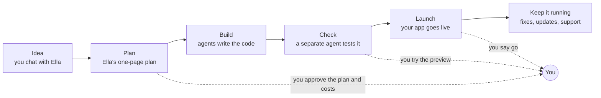

# Agentic Team

**An AI software team you can hand an idea to.**

Agentic Team is a free, open-source set of instructions. It turns the AI coding tool you already use (Claude Code, Codex, Cursor and others) into a small company: ten agents with one job each, a fixed way of working, and automatic checks on every change. You only talk to one of them, Ella. She interviews you, shows you a one-page plan with the cost, runs the rest of the team, and comes back when something needs your decision.

**Who it's for.** People with an app idea who don't write code, and developers who want AI work checked. Today you start it from a coding tool in a terminal, so a beginner may want a technical friend for the first setup. A web front door is planned ([ROADMAP.md](ROADMAP.md)).

**Why it exists.** AI tools write code fast. But they mark their own homework, forget last week's decisions and rarely tell you the cost up front.

**What you need to run it.** A coding assistant, such as Claude Code, Codex or Cursor. It won't run in an ordinary chat window like ChatGPT, the Claude app or Gemini, because those can't open the files on your computer or run commands there.

## How it's different

| | A chatbot | An app builder | A coding assistant on its own | Your coding assistant + Agentic Team |
|---|---|---|---|---|
| For example | ChatGPT, Claude, Gemini | Lovable, Bolt, Replit | Claude Code, OpenAI Codex, Cursor, GitHub Copilot | Any of those coding assistants, running this team |
| Who decides what gets built | You, one prompt at a time | You, by describing changes in a chat | You, one prompt at a time | Ella interviews you and writes a one-page plan for you to approve |
| Who checks the work | You | You, by clicking around the preview | The same AI that wrote it | A different agent, using tests written from your plan before any code existed, plus automatic checks |
| What it remembers next week | The chat | The project, on their platform | Whatever notes you kept | Everything is on GitHub: plans, decisions and test results |
| Cost | Your subscription. The rest you work out. | A monthly plan, and usage can add up | You find out later | Priced before work starts, with a short weekly spend note |
| Where your code lives | Wherever you paste it | Their platform (some sync to GitHub) | Your computer | Your own GitHub account |
| When it stops to ask you | It only answers | Rarely | When it gets stuck | Before spending money, launching, or anything that can't be undone |
| Can it run the team? | No. It can't open your files or run commands | No. You work inside their platform | Yes. That's where the team runs | Yes |

For a quick script or a one-off fix, a coding assistant on its own is enough. Agentic Team is for building something you'll keep.

**Honest caveats.**

- It's early. The team is written and tested on its own, but it hasn't yet carried a real project all the way from idea to launch. That's the next step on the [roadmap](ROADMAP.md).
- It's slower and uses more AI than one assistant. Planning and checking are separate runs, so a small change costs more than just asking.
- App builders are faster to a first version. If you want something to show by tonight, use one.
- Tests can still miss things, and the work is only as good as the AI model in your tool.
- It works best in Claude Code today. That's the only tool with its own installer, where each agent runs as a separate session. Codex and Cursor read the same instructions. Gemini CLI should work but hasn't been tested.
- Hosting and databases aren't included. You pay those providers directly. Bea, the budget agent, prices them in the plan, and free tiers come first.

## How a project goes



You're needed at a few checkpoints: approving the plan and its costs, trying each preview, any new spending, and the launch. Everything between runs on its own. Before you start, Ella's plan tells you:

- **What we'll build**, in two or three sentences.
- **What you'll need**: outside services such as where the app lives online and where its data is kept, each with an easy option, other options and the monthly cost.
- **What you'll do**: the few steps that are yours, such as creating an account, and how long each takes.
- **Who's on the team**, one line each, and why.
- **When she'll need you.**

Ask her "tell me more" about anything; otherwise she keeps it short. She'll recommend the safe path, explain why, and tell you before she tries anything she isn't sure of.

A piece of work is done when the checker passes it, every automatic check is green, and you approve it. A project is done when it reaches what its [profile](playbooks/engagement.md#project-profiles) promises.

## Your first project, step by step

### Before you start

| You need | Why | New to it? |
|---|---|---|
| A GitHub account | Your project's code and its whole history live there, in your name | [Create an account](https://docs.github.com/en/get-started/start-your-journey/creating-an-account-on-github) · [Hello World tutorial](https://docs.github.com/en/get-started/start-your-journey/hello-world) |
| An AI coding tool (Claude Code, Codex, Cursor, Gemini CLI or another) | The agents run inside it; this repo tells them how to work | [Which tools work](adapters/README.md#tools) |
| Git, and a terminal you can paste commands into | To copy the team into your project | [Install Git](https://git-scm.com/downloads) |
| A password manager, such as [Bitwarden](https://bitwarden.com/) (free) | Keys and passwords for your project go there, one folder per project, never in a chat or a file | Ella shows you when the first key comes up |

If any of this is new, Ella can walk you through it: open your coding assistant in the project folder, paste the prompt from step 3 and say you're starting from scratch.

### 1. Put the team in your project (once per project)

```bash
git clone <this repo's URL> ~/agentic-team

# any tool: copies the team into .team/ and writes AGENTS.md
~/agentic-team/adapters/generic/install.sh ~/code/my-project

# Claude Code: run this instead (does the above, plus subagents and CLAUDE.md)
~/agentic-team/adapters/claude-code/install.sh ~/code/my-project

# GitHub labels the agents use to show who holds what (needs the gh CLI, signed in)
~/agentic-team/adapters/github/labels.sh <owner>/<repo>
```

Then copy [templates/TEAM.md](templates/TEAM.md) into the project (Ella fills in the details with you at intake) and commit `.team/`, `AGENTS.md` and `TEAM.md`. For a brand-new repo, the [foundation](playbooks/foundation.md) playbook runs before any feature work; Ella starts it.

### 2. Your tool

Codex and Cursor read `AGENTS.md` as is. Claude Code uses its own installer above. Other tools need a pointer to `AGENTS.md`; [adapters/README.md](adapters/README.md) has the details and how to pick a model for each role's `tier`.

### 3. Talk to Ella

Open a session in the project and paste:

```text
You are Ella, the Engagement Lead. Read AGENTS.md and .team/roles/engagement-lead.md. <what you want, in your own words>
```

That's the only prompt you need. Start a new idea, ask for a change, ask how things are going, approve something: it all goes to Ella, and she starts the other agents. In a tool that can't start sessions on its own, she gives you the one line to paste into a new session.

Agents hand off on GitHub issues and keep the `role:`, `stage:` and `needs-human` labels current ([docs/github-state.md](docs/github-state.md)); Ella answers from there, and the dashboard will read the same data.

The team's own maintenance (the quarterly role review, tuning a role) runs in this repo: `You are Max, the Evaluator. Read roles/evaluator.md and playbooks/improve.md. Run the quarterly team review.` To pick up a tuned role in a project, re-run the installer and commit the diff. Never edit `.team/` inside a project by hand.

## What's underneath

The team itself is plain text: job descriptions (roles), a process (playbooks), automatic checks that run on GitHub, outside the agents' control (the gate kit) and one shared record (GitHub). It works with any agent tool, and each tool gets a thin adapter. A project hires the agents it needs from here instead of writing its own prompts; roles are tuned here once, and every project picks up the improvement by updating its copy. The mandates say how an agent works, never what to build; everything about a project lives in that project's own spec and its `TEAM.md`.

### The roster

| Name | Role | Department | Tier | Job in one line | Mandate |
|---|---|---|---|---|---|
| **Ella** | Engagement Lead | Advisory | deep | The only agent you talk to, on every project: guides you through the process, runs intake, coordinates everyone else, brings you decisions | [roles/engagement-lead.md](roles/engagement-lead.md) |
| **Priya** | Product Manager | Product | deep | Turns the brief or a request into an approved, testable spec and runs each ticket through build and verify | [roles/product-manager.md](roles/product-manager.md) |
| **Rohan** | Researcher | Research | deep | Answers a question from primary sources, grades the evidence, labels what it did not check | [roles/researcher.md](roles/researcher.md) |
| **Quinn** | Critic | Research | deep | Attacks a plan, idea or spec before money or code is spent on it, and adjudicates outside critique | [roles/critic.md](roles/critic.md) |
| **Arjun** | Architect | Engineering | deep | For multi-unit full specs only: acceptance map, unit order, release notes; writes no code | [roles/architect.md](roles/architect.md) |
| **Ian** | Implementer | Engineering | standard | Builds one bounded unit, writes its own tests, self-checks every acceptance row | [roles/implementer.md](roles/implementer.md) |
| **Vera** | Verifier | Engineering | deep | Writes tests from the spec before reading code, gives one verdict per revision, can block | [roles/verifier.md](roles/verifier.md) |
| **Max** | Evaluator | Engineering | deep | Measures prompt and model quality against a golden set, one variable at a time, and reports the whole score path | [roles/evaluator.md](roles/evaluator.md) |
| **Bea** | Budget Analyst | Finance | standard | Estimates cost and time as ranges, prices every new requirement, sets per-ticket caps, keeps the ledger of actual spend | [roles/budget-analyst.md](roles/budget-analyst.md) |
| **Otto** | Ops | Operations | standard | Sets up the gates, keeps repositories tidy, runs production releases with the owner's approval, monitoring and incidents | [roles/ops.md](roles/ops.md) |

Names are for easy reference: "ask Quinn to critique this", "send it to Vera". Each starts with a different letter, and most match the role's first letter. The role (the file name) stays the stable id that tools and commits use; a name can change without breaking anything.

Each role is one agent definition that can run as many copies as the work needs. Elephants (Ella, Priya, Arjun, Bea, Otto) remember a project through files in the repo; fish (Ian, Vera, Rohan, Quinn, Max) start every task fresh, which keeps them independent. See [principles.md](principles.md#memory-elephants-and-fish). The split follows Google's [Elephant-Goldfish Model](https://opensource.googleblog.com/2026/10/introducing-elephant-goldfish-model-plugin.html).

**You only talk to Ella.** She's on every project and can't be removed; every other agent is optional. She interviews you, writes the proposal with Bea's estimate, and after you sign off she runs the rest: Priya specs and runs each ticket with Ian and Vera (or Arjun for a large multi-unit build), Otto releases, Bea reports. Ella comes back to you only for decisions, each with one recommendation, and she'll tell you when a shortcut puts the project at risk. You can always overrule her.

### Playbooks

| Playbook | Use it when |
|---|---|
| [engagement](playbooks/engagement.md) | Every project: profile, proposal with cost and time, change requests, weekly status |
| [research-to-spec](playbooks/research-to-spec.md) | An idea isn't a spec yet, or a spec needs its fresh-eyes review |
| [foundation](playbooks/foundation.md) | A new project repo, before any feature work |
| [build](playbooks/build.md) | An approved spec needs code, including trivial changes and prompt or model quality |
| [production](playbooks/production.md) | Releases, monitoring, incidents, support, code health, housekeeping |
| [improve](playbooks/improve.md) | The team's own loop: retros, the quarterly role review, tuning a role |

**How we work.** The team follows *spec-driven flow*: small written specs, tickets that flow through build, independent verification and gates, and no sprints. [docs/how-we-work.md](docs/how-we-work.md) compares it with waterfall, Scrum, SAFe and Kanban, with the evidence.

### Words you'll see

| Word | Meaning |
|---|---|
| Spec, change spec | A short written description of a change with checkable acceptance criteria, approved before any code |
| Ticket | One unit of work: a GitHub issue, a branch and a pull request |
| PASS, BLOCK | Vera's verdict on an exact version of the work. BLOCK lists what's wrong |
| Typed blocker | An agent's honest "I can't do this": unclear request, missing access, too big, or impossible |
| Gate | A CI check the agents can't change, such as "existing tests weren't edited" |
| Red zone | Risky paths (sign-in, payments, migrations, infrastructure) that always need your approval |
| Autonomy stage | How much merges without you, widened one area at a time on evidence |
| Elephant, fish | Elephants remember a project through files; fish start fresh each time so they stay independent |
| Dark run | A build that runs without questions to you, except the decisions only you can make |
| Profile | The kind of project (prototype, production and so on), which sets how much process applies |

The rules every agent follows are in [principles.md](principles.md), and the evidence behind the design is in [the research report](docs/research/agentic-software-company-practices.md).

### Layout

```text
roles/        one page per agent: neutral frontmatter (tier, capabilities) and its mandate
playbooks/    the six ways agents work together
templates/    what a project copies: TEAM.md, AGENTS.md, DESIGN.md, spec.md, documents.md, budget/, the foundation kit
adapters/     install scripts (generic, Claude Code) and the GitHub label script
docs/         how we work, the GitHub state contract, the research behind the design
evals/        test cases for the roles and two end-to-end sample projects (see improve)
tools/        the free checks and the sandbox that runs the cases
```
