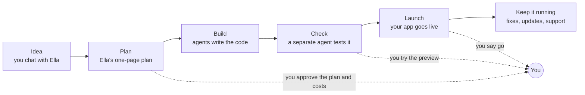

# Agentic Team

**An AI software team you can hand an idea to.**

Agentic Team is a free, open-source set of instructions. It turns the AI coding tool you already use (Claude Code, Codex, Cursor and others) into a small company: ten agents with one job each, a fixed way of working, and automatic checks on every change. You only talk to one of them, Ella. She interviews you, shows you a one-page plan with the cost, runs the rest of the team, and comes back when something needs your decision.

**Who it's for.** People with an app idea who don't write code, and developers who want AI work checked. Today you start it from a coding tool in a terminal, so a beginner may want a technical friend for the first setup. A web front door is planned ([ROADMAP.md](ROADMAP.md)).

**Why it exists.** AI tools write code fast. But they mark their own homework, forget last week's decisions and rarely tell you the cost up front.

**What you need to run it.** A coding assistant, such as Claude Code, Codex or Cursor. It won't run in an ordinary chat window like ChatGPT, the Claude app or Gemini, because those can't open the files on your computer or run commands there.

## How it's different

| | A chatbot | An app builder | A coding assistant on its own | Your coding assistant + Agentic Team |
|---|---|---|---|---|
| For example | ChatGPT, Claude, Gemini | Lovable, Bolt, Replit | Claude Code, OpenAI Codex, Cursor, GitHub Copilot | Any of those coding assistants, running this team |
| Who decides what gets built | You, one prompt at a time | You, by describing changes in a chat | You, one prompt at a time | Ella interviews you and writes a one-page plan for you to approve |
| Who checks the work | You | You, by clicking around the preview | The same AI that wrote it | A different agent, with tests written from your plan before any code existed |
| What it remembers next week | The chat | The project, on their platform | Whatever notes you kept | Everything, on your own GitHub: plans, decisions and test results |
| Cost | Your subscription. The rest you work out. | A monthly plan, and usage can add up | You find out later | Priced before work starts, with a short weekly spend note |

For a quick script or a one-off fix, a coding assistant on its own is enough. Agentic Team is for building something you'll keep.

**Honest caveats.**

- It's early. The team is written and tested on its own, but it hasn't yet carried a real project all the way from idea to launch. That's the next step on the [roadmap](ROADMAP.md).
- It's slower and uses more AI than one assistant. Planning and checking are separate runs, so a small change costs more than just asking.
- App builders are faster to a first version. If you want something to show by tonight, use one.
- Tests can still miss things, and the work is only as good as the AI model in your tool.
- It works best in Claude Code today. That's the only tool with its own installer, where each agent runs as a separate session. Codex and Cursor read the same instructions. Gemini CLI should work but hasn't been tested.
- Hosting and databases aren't included. You pay those providers directly. Bea, the budget agent, prices them in the plan, and free tiers come first.

## How a project goes




You're needed at a few checkpoints: approving the plan and its costs, trying each preview, any new spending, and the launch. Everything between runs on its own. Ask Ella "tell me more" about anything; otherwise she keeps it short.

## Your first project

This is the whole setup. If any of it is new, the learning portal's "Your first project" lesson walks through the same steps with more help.

**1. Get four things ready.** A [GitHub account](https://docs.github.com/en/get-started/start-your-journey/creating-an-account-on-github), an AI coding tool ([which ones work](adapters/README.md#tools)), [Git](https://git-scm.com/downloads) and a terminal, and a password manager such as [Bitwarden](https://bitwarden.com/) for your project's keys.

**2. Download the team, once.** The URL is under the green Code button on this repo's GitHub page.

```bash
git clone <that URL> ~/agentic-team
```

**3. Put the team in your project folder.** Then commit the new files.

```bash
# any tool
~/agentic-team/adapters/generic/install.sh ~/code/my-project

# or, if you use Claude Code
~/agentic-team/adapters/claude-code/install.sh ~/code/my-project
```

**4. Say hello to Ella.** Open your coding assistant in the project folder and paste this, with your idea at the end:

```text
You are Ella, the Engagement Lead. Read AGENTS.md and .team/roles/engagement-lead.md. <what you want, in your own words>
```

That's the only prompt you need. New ideas, changes, questions and approvals all go to Ella, and she starts the other agents. She sets up the rest with you, including the project's `TEAM.md` and its GitHub labels. Tool-by-tool details are in [install in a project](adapters/README.md).

## What's underneath

The team is plain text that works with any agent tool:

- [Meet the team](learn/docs-team.md): the ten agents and what each one does.
- [Playbooks](learn/docs-playbooks.md): how they work together at each stage.
- [How we work](docs/how-we-work.md): the method, and the words you'll see.
- [Principles](principles.md): the rules every agent follows.
- [Roadmap](ROADMAP.md) and [the research behind the design](docs/research/agentic-software-company-practices.md).

Roles are tuned here once, and every project picks up the change by re-running the installer. Never edit `.team/` inside a project by hand. The team's own upkeep runs in this repo: `You are Max, the Evaluator. Read roles/evaluator.md and playbooks/improve.md. Run the quarterly team review.`

## Layout

```text
roles/        one page per agent: neutral frontmatter (tier, capabilities, skills) and its mandate
skills/       how-tos a role loads for one task (open Agent Skills format), ours and vetted outside ones
playbooks/    the six ways agents work together
templates/    what a project copies: TEAM.md, AGENTS.md, DESIGN.md, spec.md, documents.md, budget/, the foundation kit
adapters/     install scripts (generic, Claude Code) and the GitHub label script
docs/         how we work, the GitHub state contract, the research behind the design
evals/        test cases for the roles and two end-to-end sample projects (see improve)
tools/        the free checks and the sandbox that runs the cases
```

## Licence

Apache-2.0 ([LICENSE](LICENSE)), except folders in `skills/` that have an `UPSTREAM.md`: those are copied unchanged from other projects and stay under the licence in their own LICENSE file (Apache-2.0, MIT or CC BY-SA 4.0).
