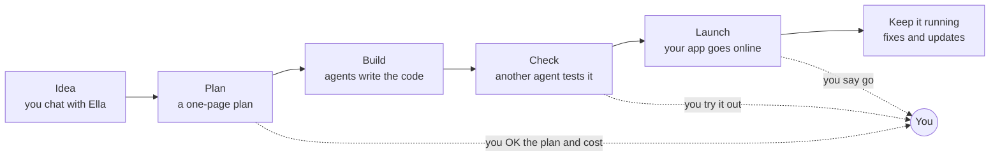

# Agentic Team

**An AI software team you can hand an idea to.**

You have an idea for an app. You tell it to Ella, an AI agent. An agent is an AI that does one job by itself. Ella asks you some questions, writes a short plan and tells you what it will cost. When you say yes, she gets a team of agents to build it. Each agent has one job. One agent builds, and a different one checks the work. Ella comes back to you only when you need to decide something.

It's free. It's a set of written instructions that you add to an AI coding assistant, such as Claude Code, Codex or Cursor. A coding assistant is an AI that can open and change the files on your computer.

## Who it's for

People with an app idea who have never written code. Developers who want one AI's work checked by another can use it too.

To start, you type a few commands into a terminal. A terminal is a window where you type instructions for your computer. If that's new to you, ask a friend who knows computers to help the first time. A simpler website to start from is planned ([roadmap](ROADMAP.md)).

## Why it exists

AI tools write code fast. But they check their own work, forget what you agreed last week and don't tell you the cost before they start.

## What you need

A coding assistant, such as Claude Code, Codex or Cursor. A chatbot like ChatGPT, the Claude app or Gemini won't work. Chatbots can talk and write, but they can't open the files on your computer or run anything there.

## How it's different

| | A chatbot | An app builder | A coding assistant on its own | A coding assistant + Agentic Team |
|---|---|---|---|---|
| For example | ChatGPT, Claude, Gemini | Lovable, Bolt, Replit | Claude Code, OpenAI Codex, Cursor, GitHub Copilot | Any of those coding assistants, with this team added |
| Who decides what to build | You, one message at a time | You, by chatting | You, one message at a time | Ella asks you questions, then writes a one-page plan for you to OK |
| Who checks the work | You | You, by trying the app | The same AI that built it | A different agent. It writes its tests from your plan before the code exists |
| What it remembers next week | The chat | Your app, on their website | Notes you kept yourself | Everything: plans, choices and test results, kept in your own GitHub account |
| Cost | Your subscription. You work out the rest. | A monthly plan, plus extra if you use a lot | You find out later | You see the price before work starts, and get a short spending note each week |

For a quick one-time fix, a coding assistant on its own is enough. This team is for an app you want to keep.

## Before you start, know this

- It's new. It hasn't built a real app all the way from idea to launch yet. That's the next step.
- It's slower than one coding assistant on its own, and it uses more AI, so it costs more. Planning and checking are extra steps.
- App builders get you a first version faster. If you need something to show tonight, use one.
- Tests can still miss mistakes. The work is only as good as the AI in your coding assistant.
- It works best in Claude Code today. Codex and Cursor read the same instructions. Nobody has tried Gemini CLI yet.
- Putting your app online and storing its data cost extra. You pay those companies yourself. Bea, the agent who handles money, puts those costs in the plan and picks free options first.

## How a project goes



Ella needs you at a few points: to OK the plan and cost, to try each new version, before any new spending, and before launch. The team does the rest. Ask Ella "tell me more" about anything. If you don't, she keeps things short.

## Your first project

Here's the whole setup. The "Your first project" lesson on our website shows the same steps with more help.

**1. Get four things ready.**

- A GitHub account. GitHub is a website that keeps your app's code, and every change to it, safe in your name. [Create an account](https://docs.github.com/en/get-started/start-your-journey/creating-an-account-on-github).
- A coding assistant. [See which ones work](adapters/README.md#tools).
- Git, a free program that copies code between GitHub and your computer. [Get Git](https://git-scm.com/downloads).
- A password manager, such as [Bitwarden](https://bitwarden.com/) (free). Your project's passwords and keys go there, never in a chat.

**2. Copy the team to your computer.** You only do this once. Find this page's web address under the green Code button on GitHub. Then type this in your terminal, with that address in place of `<that address>`:

```bash
git clone <that address> ~/agentic-team
```

**3. Add the team to your project folder.** Type one of these. Then save the new files to GitHub. Saving to GitHub is called a commit, and Ella can show you how.

```bash
# most tools
~/agentic-team/adapters/generic/install.sh ~/code/my-project

# or, if you use Claude Code
~/agentic-team/adapters/claude-code/install.sh ~/code/my-project
```

**4. Say hello to Ella.** Open your coding assistant in your project folder. Paste this line and add your idea at the end:

```text
You are Ella, the Engagement Lead. Read AGENTS.md and .team/roles/engagement-lead.md. <what you want, in your own words>
```

That's the only line you need to remember. New ideas, changes, questions and OKs all go to Ella. She brings in the other agents and sets up the rest with you. The [install guide](adapters/README.md) has more detail for each tool.

## Learn more

- [Meet the team](learn/docs-team.md): the ten agents and their jobs.
- [Playbooks](learn/docs-playbooks.md): the steps they follow at each stage.
- [How we work](docs/how-we-work.md): our way of working, and a list of words you'll see.
- [Principles](principles.md): the rules every agent follows.
- [Roadmap](ROADMAP.md), and [the research behind the team](docs/research/agentic-software-company-practices.md).

## For people who change the team itself

The team is plain text files. We improve an agent here once, and every project gets the change when it runs the install again. Don't edit the `.team/` folder inside a project. To run the team's quarterly review, paste: `You are Max, the Evaluator. Read roles/evaluator.md and playbooks/improve.md. Run the quarterly team review.`

## Layout

```text
roles/        one page per agent: neutral frontmatter (tier, capabilities, skills) and its mandate
skills/       how-tos a role loads for one task (open Agent Skills format), ours and vetted outside ones
playbooks/    the six ways agents work together
templates/    what a project copies: TEAM.md, AGENTS.md, DESIGN.md, spec.md, documents.md, budget/, the foundation kit
adapters/     install scripts (generic, Claude Code) and the GitHub label script
docs/         how we work, the GitHub state contract, the research behind the design
evals/        test cases for the roles and two end-to-end sample projects (see improve)
tools/        the free checks and the sandbox that runs the cases
```

## Licence

Apache-2.0 ([LICENSE](LICENSE)), except folders in `skills/` that have an `UPSTREAM.md`: those are copied unchanged from other projects and stay under the licence in their own LICENSE file (Apache-2.0, MIT or CC BY-SA 4.0).
